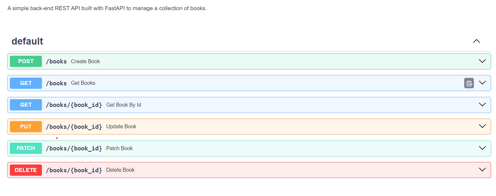
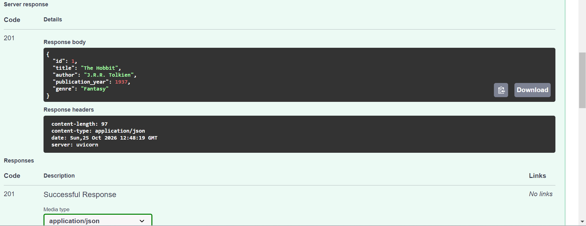
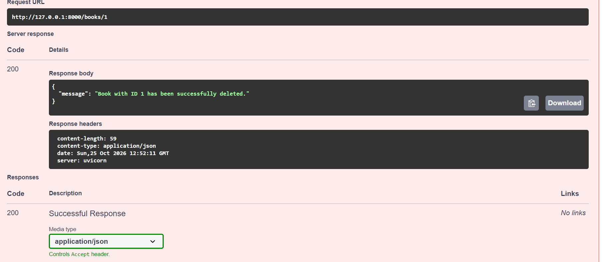
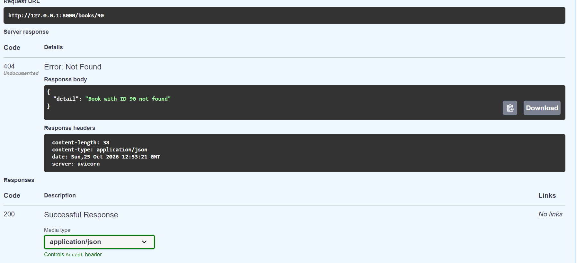

# Book Management API 
A streamlined back-end REST API built using Python and FastAPI framework to manage an in-memory collection of books.
## Features
* **Full CRUD Operations**: Create, read, update, and delete book entries.
* **Data Validation**: Enforced using Pydantic schemas.
* **Automatic ID Generation**: Book IDs handle themselves sequentially.
* **Filtering & Pagination**: Support for query parameter sorting by genre and payload constraints.
* **Search Functionality**: Advanced title and author lookup parameters.
## API Endpoints Summary
| Method | Endpoint | Description |
| :--- | :--- | :--- |
| **POST** | `/books` | Add a new book record |
| **GET** | `/books` | List all books (Supports `genre`, `search`, `limit`) |
| **GET** | `/books/{book_id}` | Retrieve a book by its unique ID |
| **PUT** | `/books/{book_id}` | Replace/Update an entire book profile |
| **PATCH** | `/books/{book_id}` | Partially update specific book attributes |
| **DELETE**| `/books/{book_id}` | Delete a book entry |
## Technologies Used
* **Python 3.x**
* **FastAPI**
* **Uvicorn** (ASGI Web Server)
* **Pydantic** (Data validation structural schemas)
## Installation and Setup
1. **Clone the repository:**
   ```bash
   git clone https://github.com
   cd book-management-api
   ```
2. **Create and Activate a Virtual Environment:**
   ```bash
   python -m venv venv
   .\venv\Scripts\activate
   ```
3. **Install Dependencies:**
   ```bash
   pip install -r requirements.txt
   ```
## How to Run the Project 
Start the local development server using Uvicorn:
```bash
uvicorn main:app --reload
```
The server will boot up natively at `http://127.0.0.1:8000`.
## API Documentation and Screenshots
FastAPI automatically generates an interactive documentation page. Once your server is running, navigate to:
* **Interactive Docs UI:** `http://127.0.0`
### Interactive Documentation Layout

### Successful Book Creation (POST)

### Update or Delete Operation

### Error Response (Book Does Not Exist)

